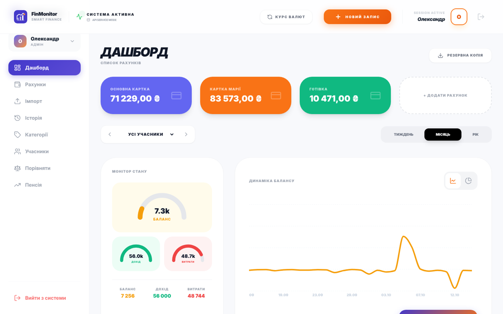
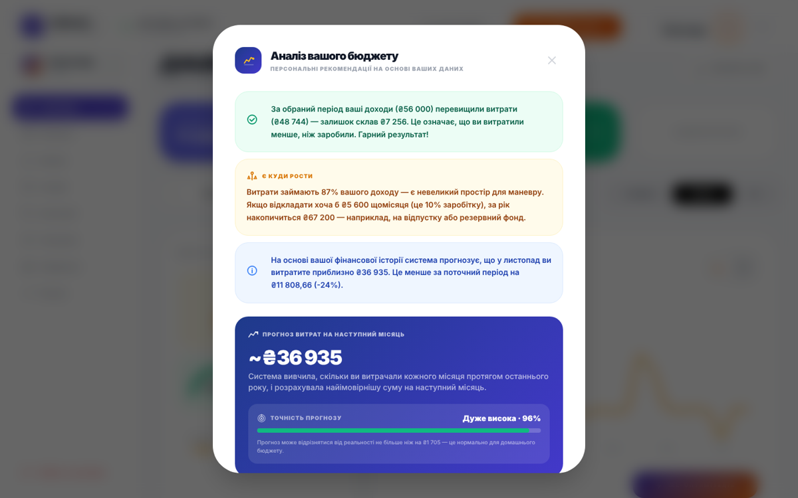
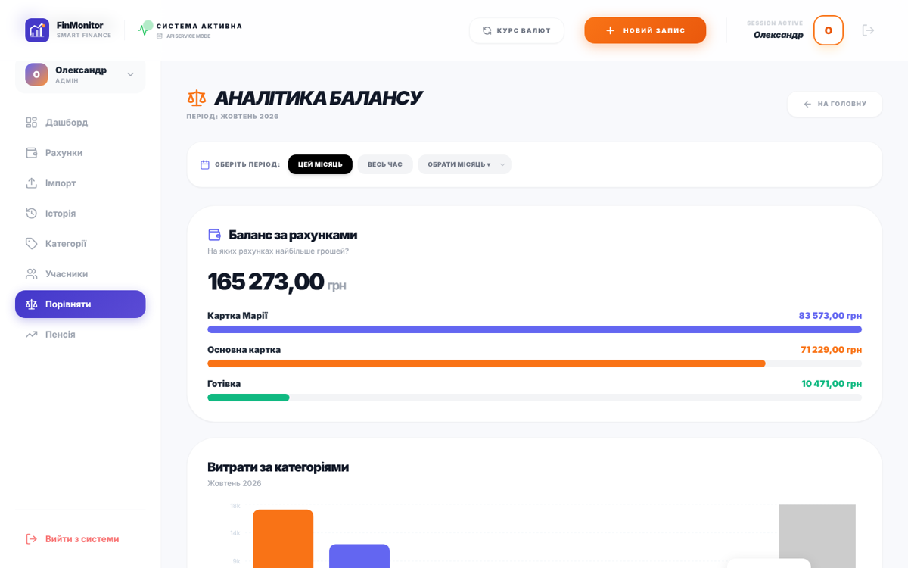
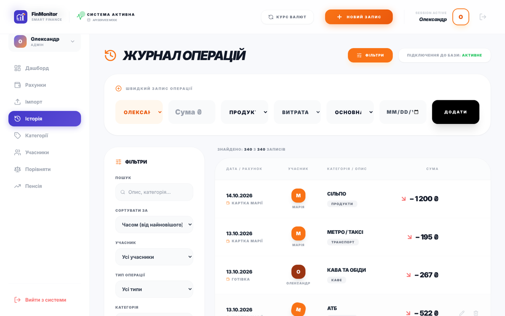

# FinMonitor — Household Expense Analytics & ML Forecasting

[](https://github.com/Sofiia-Skrypai/Financial-monitor/actions/workflows/ci.yml)
[](https://github.com/Sofiia-Skrypai/Financial-monitor/actions/workflows/deploy.yml)


**An intelligent web system for tracking, analysing and forecasting household expenses using machine learning.**
Bachelor's thesis project «Intelligent system for forecasting household expenditure based on machine learning methods» —
Taras Shevchenko National University of Kyiv, Computer Science (122), Data Analytics track.

### 🔗 [Live demo → sofiia-skrypai.github.io/Financial-monitor](https://sofiia-skrypai.github.io/Financial-monitor/)

> Click **«Переглянути демо з тестовими даними»** on the login screen — the app loads 8 months of realistic
> family transactions so you can explore the dashboards and the ML forecast in one click. No sign-up needed.
> All data stays in your browser (localStorage). The interface is in Ukrainian.
> Admin secret code for the demo account: **`DEMO2026`** (shown as a hint on the admin confirmation screen).



---

## Business problem

Most families don't know where their money goes or how much they will spend next month. Bank apps show
transactions per card, but a household usually has several cards, cash, and several family members.

**FinMonitor** consolidates all of a household's accounts and members in one place and answers three questions:

1. **Where does the money go?** — spending structure by category, member, account and period.
2. **How much will we spend next month?** — a Random Forest forecast with quality metrics.
3. **What can we optimise?** — data-driven recommendations and a retirement-savings planner.

The market analysis in the thesis showed a gap: none of the reviewed personal-finance products combines operational
transaction tracking, predictive analytics and long-term savings planning in one system. The "AS IS" business process
of manual budgeting was modelled in **IDEF0**, and functional requirements were prioritised — all *Must have*
requirements are implemented.

## Research highlights

* Compared statistical (ARIMA-family), ensemble and neural-network methods for short financial time series;
  **Random Forest** was selected as the most robust for small samples typical of personal finance.
* Forecast quality of the trained model: **R² = 0.88**.
* Designed the conceptual, logical and physical data models and the system's functional decomposition.
* **Hybrid two-stage OCR** for fiscal receipts: Tesseract.js with consensus voting as the primary channel,
  a vision LLM as a fallback.
* Retirement model: future value of an annuity with inflation adjustment and calculation of the required monthly contribution.

## Key features

| Area | What it does |
|---|---|
| 📊 **Analytics dashboard** | Balance, income and expense KPIs; balance dynamics (line chart); category structure (pie); each family member's contribution — filterable by week / month / year and member |
| 🤖 **ML forecasting** | Random Forest Regressor (100 trees) trained on monthly expense series; next-month forecast with **RMSE, R², MAPE**-based accuracy; personalised saving recommendations by category |
| ⚖️ **Comparative analysis** | Balance by account, expenses by category, period-over-period comparison, per-category forecasts; **PDF report export** (jsPDF + AutoTable, Cyrillic font) |
| 📥 **Data import (ETL)** | Upload bank statements from **Monobank / PrivatBank** (CSV, XLS/XLSX) with automatic column mapping, date parsing and category normalisation; direct **Monobank API** sync; JSON backup / restore |
| 🧾 **Receipt OCR** | Recognises the total amount on a photo of a receipt — Tesseract.js (`ukr+eng`) with consensus voting, vision-LLM fallback (needs an API key, not enabled in the public demo) |
| 🏷️ **Categories & budget limits** | Custom categories with monthly limits and over-limit notifications |
| 👨‍👩‍👧 **Family mode (RBAC)** | Admin + members; admin grants access to sections per member; secret-code protection for the admin profile |
| 💰 **Retirement planner** | Future value of regular contributions (annuity formula) for conservative / moderate / aggressive strategies, with inflation adjustment |
| 💱 **Multi-currency** | UAH / USD / EUR accounts with configurable exchange rates |

## Screenshots

| ML forecast & recommendations | Comparative analytics |
|---|---|
|  |  |
| **Transaction log with filters** | **Retirement planner** |
|  |  |

## ML approach

```
transactions ──► filter "expense" ──► aggregate by calendar month ──► time series y₁…yₙ
                                                                          │
                     X = month index, y = monthly expenses                ▼
                 Random Forest Regressor (100 trees, bootstrap, seed 42) ──► ŷₙ₊₁ (next month)
                                                                          │
                                                       RMSE · R² · MAPE ◄─┘  → accuracy = 1 − MAPE
```

* **Model:** Random Forest Regressor — robust to outliers (one-off large purchases) and works on short series.
  Implemented natively in JavaScript in the browser ([`Dashboard.js`](client/src/pages/Dashboard.js)) so the
  forecast runs with no backend; the reference implementation in Python/scikit-learn is in
  [`server/predict.py`](server/predict.py).
* **Fallback:** with < 3 months of history the system uses a daily-run-rate estimate and tells the user the forecast is approximate.
* **Recommendations:** categories whose share of spending is above a threshold get a suggested cut and the yearly saving it would produce.

```bash
cd server && pip install -r requirements.txt && python predict.py
# {"forecast_next_month": 20050.68, "rmse": 298.8, "r2": 0.8356, "mape_pct": 1.34, ...}
```

## Tech stack

| Layer | Technologies |
|---|---|
| Frontend | React 19, React Router 7, Redux Toolkit, Tailwind CSS 3, Recharts, Lucide icons |
| Data processing | SheetJS (xlsx), custom CSV/XLS parsers, Tesseract.js (OCR), jsPDF |
| ML | Random Forest (JS implementation), Python · pandas · NumPy · scikit-learn |
| Backend (optional) | Node.js, Express 5, MongoDB / Mongoose — REST API for accounts & transactions |
| Testing / QA | Jest (93 unit, RBAC, integration and E2E-regression tests + HTML report), React Testing Library |
| CI/CD | GitHub Actions — lint + tests + build on every push, auto-deploy to GitHub Pages |

## Architecture

```
Financial-monitor/
├── client/                 # React SPA (works standalone — data in localStorage)
│   └── src/
│       ├── pages/          # Dashboard, Compare, History, Import, Accounts, Categories, Pension, Users
│       ├── components/     # Auth, Sidebar, MemberPicker, AddTransactionModal, ReceiptScanner
│       ├── services/api.js # data layer: offline (localStorage) ⇄ REST API switch
│       ├── demo/           # demo dataset generator
│       └── store/          # Redux Toolkit store
├── server/                 # Express + MongoDB REST API, Python ML module
├── finmonitor-tests/       # QA test suite (Jest) + HTML test report generator
├── docs/screenshots/
└── .github/workflows/      # CI and GitHub Pages deployment
```

The data layer (`services/api.js`) abstracts storage: by default the app runs **offline-first** in the browser;
setting `REACT_APP_OFFLINE_MODE=false` switches it to the Express/MongoDB API.

## Run locally

Requirements: Node.js 18+ (Python 3.10+ only for `predict.py`, MongoDB only for the optional API).

```bash
git clone https://github.com/Sofiia-Skrypai/Financial-monitor.git
cd Financial-monitor/client
npm install
npm start                 # http://localhost:3000
```

Optional backend:

```bash
cd server
cp .env.example .env      # set MONGO_URL
npm install
npm start                 # http://localhost:5000/api/accounts
```

## Testing

```bash
cd finmonitor-tests && npm install
npm test                  # 93 tests: auth, RBAC, transactions & balances, categories, pension, E2E regression
npm run report            # generates test-report.html

cd ../client
npm test -- --watchAll=false   # React component tests
```

| Suite | Covers |
|---|---|
| `01_auth` | registration / login validation, password strength, sessions, secret code |
| `02_rbac` | admin vs member permissions, granted paths |
| `03_transactions` | saving, account balance recalculation, editing |
| `04_categories_pension` | category CRUD, budget limits, future-value formula, inflation |
| `05_e2e_regression` | full flow: register → add transaction → balance, filters, backup/restore |

## Limitations & roadmap

* Demo storage is the browser's localStorage — authentication is client-side and intended for demonstration only;
  production use requires server-side auth (hashed passwords, JWT) on top of the existing REST API.
* The forecast uses one feature (time index); next steps — add seasonality / lag features, compare with
  SARIMA / Prophet / gradient boosting, and evaluate on a hold-out month instead of in-sample error.
* Planned (from the thesis): automatic sync via bank APIs, an **LSTM** model to improve accuracy,
  a mobile app, and a B2B version for fintech companies.
* Mobile-responsive layout.

## Author

**Sofiia Skrypai** — Data / Business Analyst
[GitHub](https://github.com/Sofiia-Skrypai)

Licensed under the [MIT License](LICENSE).
